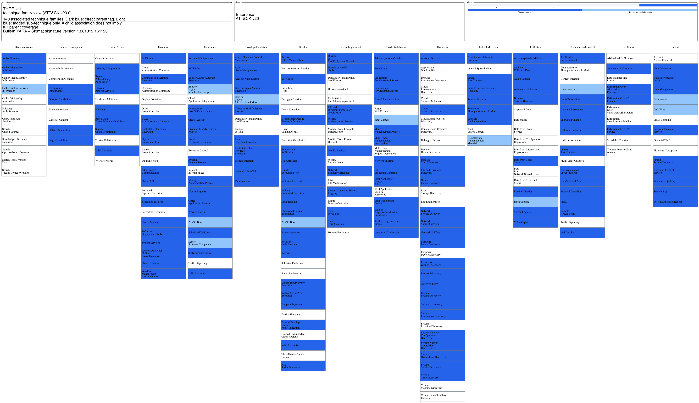
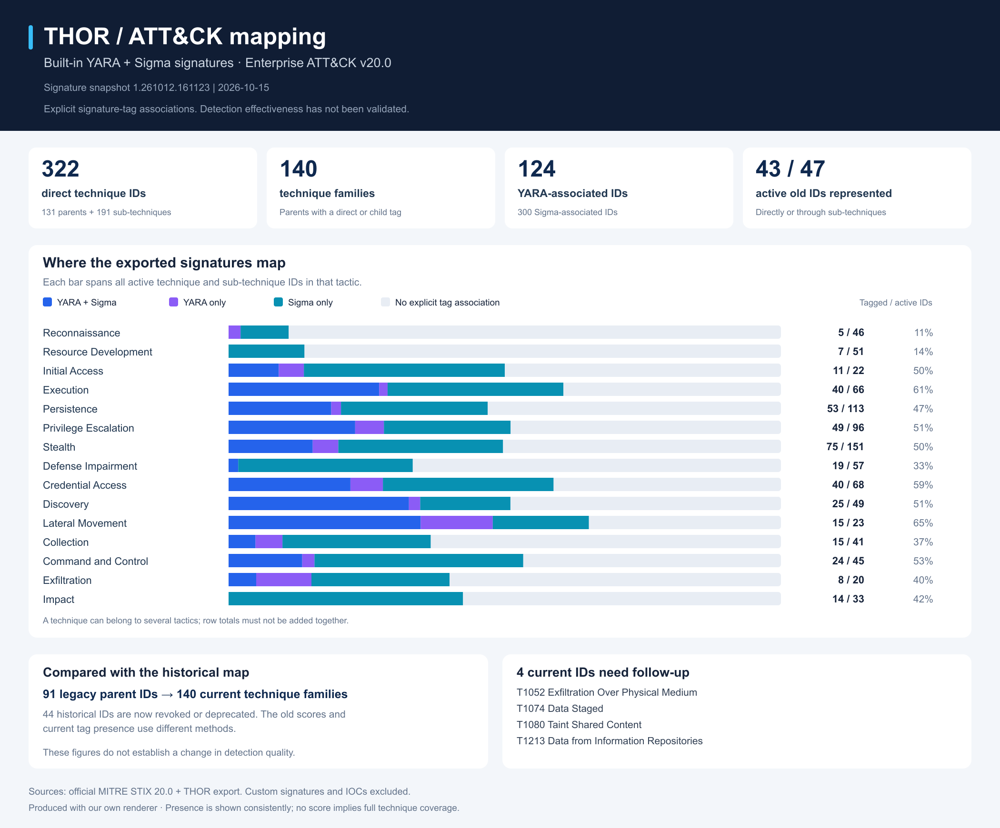

# THOR ATT&CK mapping

Versioned MITRE ATT&CK Navigator layers built from THOR's exported signature metadata.

The current snapshot uses **Enterprise ATT&CK v20.0** and THOR signature revision
**1.261012.161123**. A highlighted technique has an explicit tag association in at
least one exported built-in signature. These associations do not establish
detection effectiveness or full technique coverage.

| Layer | Direct active technique/sub-technique IDs |
| --- | ---: |
| [YARA + Sigma](THOR_APT_Scanner.json) | 322 |
| [YARA](layers/THOR_APT_Scanner_yara.json) | 124 |
| [Sigma](layers/THOR_APT_Scanner_sigma.json) | 300 |

Import a layer into [ATT&CK Navigator](https://mitre-attack.github.io/attack-navigator/).
The combined layer spans 140 technique families. Custom signatures and IOCs are
excluded from the maps; they remain in the source export.

## Images

The family view uses MITRE's official `mitreattack-python` exporter. Dark blue means
a direct parent tag; light blue means an associated sub-technique only.



[Family SVG](img/THOR_APT_Scanner.svg) ·
[Detailed SVG](img/THOR_APT_Scanner-detailed.svg) ·
[Detailed PNG](img/THOR_APT_Scanner-detailed.png)

Our overview separates YARA-only, Sigma-only and shared associations:



[Overview SVG](img/thor_attack_overview.svg)

## Source and method

The [exact signature export](data/thor-signatures_261015.json) is included as the
input evidence. [Provenance](data/provenance.json) records its SHA256 checksum,
signature revision, and the versions and checksums of the official MITRE bundles.
The export lists loaded signatures; its loading filters were not recorded.

- Normalize `T1059_001`, `T1059.001`, and `attack.t1059.001` to the same technique
  ID when reading. Existing signature and YaraTagger tag names are preserved.
- Count each export entry once per normalized technique. Per-kind counts appear
  in layer metadata; the published score is binary presence, not a strength score.
- Highlight only active Enterprise IDs. Revoked, malformed and other-domain
  technique IDs appear in the [review list](data/technique-tag-review.csv).
  Official successors are review suggestions, never automatic replacements.
- Keep parent navigation separate from direct parent associations. No child
  techniques or platform-specific detection claims are inferred.
- An annotation without a tactic appears under every official tactic for that
  technique. Its detection in each tactical context has not been validated.

## Comparison with the historical map

The previous map and images are retained in [archive/](archive/README.md).
It contained 91 parent IDs; 44 are now revoked or deprecated. Of the 47 still
active, 43 are represented directly or through sub-techniques in this snapshot.
`T1052`, `T1074`, `T1080`, and `T1213` remain mapping-review items. The historical
20–100 scores and the new tag-presence scores use different methods.

[Comparison data](data/mapping-comparison.json) ·
[Mapping summary](data/mapping-summary.json) ·
[Renderer versions](data/renderer-provenance.json)

## Regenerate

Python 3.9+ is sufficient for map generation and tests. Rendering additionally
requires the packages in `requirements-render.txt`; PNG generation uses
`rsvg-convert` from librsvg. No raw export is uploaded to a rendering service.

Download the pinned reference bundles from the
[official MITRE STIX repository](https://github.com/mitre-attack/attack-stix-data):

```sh
mkdir -p .local/attack
for domain in enterprise-attack mobile-attack ics-attack; do
  curl --fail --location \
    "https://raw.githubusercontent.com/mitre-attack/attack-stix-data/master/$domain/$domain-20.0.json" \
    --output ".local/attack/$domain-20.0.json"
done

python3 tools/build_maps.py data/thor-signatures_261015.json \
  --attack-dir .local/attack --attack-version 20.0 \
  --snapshot-date 2026-10-15 --output-dir .

python3 -m venv .venv
.venv/bin/pip install -r requirements-render.txt
.venv/bin/python tools/render_maps.py \
  --attack-dir .local/attack --attack-version 20.0 --output-dir . --png

python3 -m unittest discover -s tests -v
```

Check downloaded bundle hashes against `data/provenance.json` when reproducing
this exact snapshot. Font availability and the librsvg version can affect image
bytes; the layers and mapping statistics are deterministic for the same inputs.

For a more detailed local audit, including all export kinds and origins:

```sh
python3 tools/audit_attack.py data/thor-signatures_261015.json \
  --attack-dir .local/attack --attack-version 20.0 \
  --old-layer archive/THOR_APT_Scanner.json --output .local/audit
```

That audit produces a count-based draft layer. The published layers generated by
`build_maps.py` use binary presence and include both YARA and Sigma.
